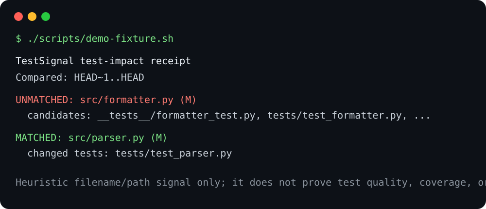

# TestSignal

TestSignal is a small, offline Git-diff receipt for a narrow review question:
when a Python, JavaScript, or TypeScript production file changed, did a likely
matching test file change too?

It is designed for maintainers reviewing AI-assisted patches who want a fast,
auditable signal before they run their normal test suite. It reads Git diff
filenames only—never source contents—and uses documented path conventions.
There are no packages, accounts, API keys, telemetry, or network calls.



> This is a heuristic naming/path signal. It does **not** prove test quality,
> coverage, behavioural correctness, or patch safety.

## Quick start

Requirements: Python 3.9+ and Git. Clone this repository, then from its root:

```sh
PYTHONPATH=src python3 -m testsignal --base HEAD~1 --head HEAD
```

For JSON suitable for a local CI wrapper:

```sh
PYTHONPATH=src python3 -m testsignal --base origin/main --head HEAD --format json
```

Use strict mode only when your team wants an unmatched *supported* source
change to stop the command:

```sh
PYTHONPATH=src python3 -m testsignal --strict
```

The committed demo is reproducible and creates a disposable fixture repository:

```sh
./scripts/demo-fixture.sh
```

## What it reports

TestSignal runs `git diff --name-status -M`, then classifies changed paths as
source, test, excluded, or unsupported. It supports `.py`, `.js`, `.jsx`,
`.ts`, and `.tsx` source files under `src/` or `lib/` by default. Test paths
include `tests/`, `test/`, and `__tests__/`, plus conventional `test_*.py`,
`*_test.py`, `*.test.*`, and `*.spec.*` names.

For each active supported source change it shows:

- `matched` when a changed test path is one of its conventional candidates;
- `unmatched` and the deterministic candidate list otherwise.

Deleted source files are reported but are not requirements in v1. Unsupported
extensions and excluded paths never fail strict mode.

## Local policy

Optionally add a checked-in `.testsignal.json`:

```json
{
  "source_roots": ["src", "lib"],
  "test_roots": ["tests", "test", "__tests__"],
  "exclude": ["vendor/**", "generated/**"],
  "strict": false
}
```

Only these keys are accepted. Invalid JSON or policy shapes fail clearly with
exit code 2 instead of silently changing the review policy.

## Verify

```sh
PYTHONPATH=src python3 -m unittest discover -s tests -v
./scripts/demo-fixture.sh
```

The automated suite uses temporary Git repositories to exercise real diff
parsing, matched/unmatched results, strict failure, exclusions, unsupported
files, and clean errors for bad revisions.

## Limitations

Custom layouts, generated sources, monorepos, nonstandard naming, renamed
tests, and weak tests need human judgment or local configuration. TestSignal
does not execute tests, inspect code, measure coverage, parse languages, or
contact any external service.

## License

[MIT](LICENSE)
